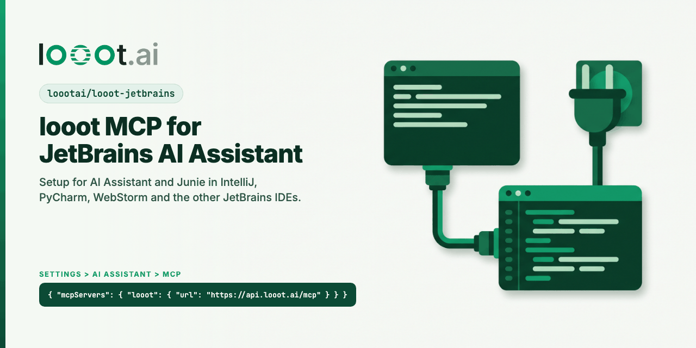

<p align="center"></p>

# looot for JetBrains IDEs

[](LICENSE) [](https://docs.looot.ai)

looot gives an AI agent one key and one prepaid balance for 2,500+ data API endpoints from 90+ providers: work emails, phone numbers, company and people search, Google results, web pages, news, LinkedIn profiles, local businesses. The agent sees the price before it runs, and a failed call costs nothing. Top up from $5.

## Install for agents

```bash
claude mcp add --transport http looot https://api.looot.ai/mcp
```

See also: [awesome-looot-use-cases](https://github.com/loootai/awesome-looot-use-cases) (copy-paste recipes) and [awesome-gtm](https://github.com/loootai/awesome-gtm) (open-source GTM tools).

JetBrains has no plugin API for registering an external MCP server, and no marketplace listing for one. The plugin extension points in the IDE expose IDE tools as an MCP server, which is the opposite direction. So there is no looot plugin. Setup is a JSON paste, and it works in every IDE that has AI Assistant 2026.1 or newer (IntelliJ IDEA, PyCharm, WebStorm, GoLand, Rider and the rest).

## AI Assistant

1. Open Settings | Tools | AI Assistant | Model Context Protocol (MCP).
2. Click Add.
3. Choose the HTTP (Streamable HTTP) transport and paste:

```json
{
  "mcpServers": {
    "looot": {
      "url": "https://api.looot.ai/mcp"
    }
  }
}
```

4. Click OK, then Apply. The looot tools appear in the AI Assistant chat.

If you already added looot to Claude Desktop, use "Import from Claude" on the same page.

## Junie

Junie searches the official MCP registry, and looot is listed there as `ai.looot/looot`. In the Junie CLI, run `/mcp`, press Ctrl+A and search for looot, or ask the Installation Assistant to add it.

To add it by hand, use Settings | Tools | Junie | MCP Settings, or put the same JSON in one of these files:

- `.junie/mcp/mcp.json` in the project (shared with the team if you commit it, so keep API keys out of it)
- `~/.junie/mcp/mcp.json` for every project on your machine

## Project Clients Auto-Configuration

Settings | Tools | MCP Server | Project Clients Auto-Configuration only configures external clients to use the IDE's own MCP server. It does not add looot. Use the AI Assistant or Junie steps above.

## Agent token instead of browser sign-in

If the browser sign-in does not suit your setup, create an agent token in the looot dashboard and send it as a header:

```json
{
  "mcpServers": {
    "looot": {
      "url": "https://api.looot.ai/mcp",
      "headers": { "Authorization": "Bearer YOUR_LOOOT_TOKEN" }
    }
  }
}
```

Keep the token out of version control. Headers are untested here in a JetBrains IDE.

## Sign-in

looot's server uses OAuth in the browser. The JetBrains docs do not say whether remote servers support OAuth, and we have not tested this in a JetBrains IDE yet. If the sign-in window does not open, contact https://looot.ai/contact.

[looot.ai](https://looot.ai) | [Docs](https://docs.looot.ai) | [Support](https://looot.ai/contact)
